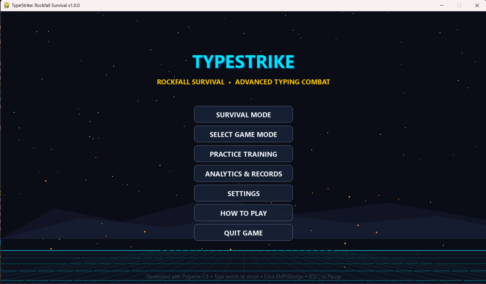
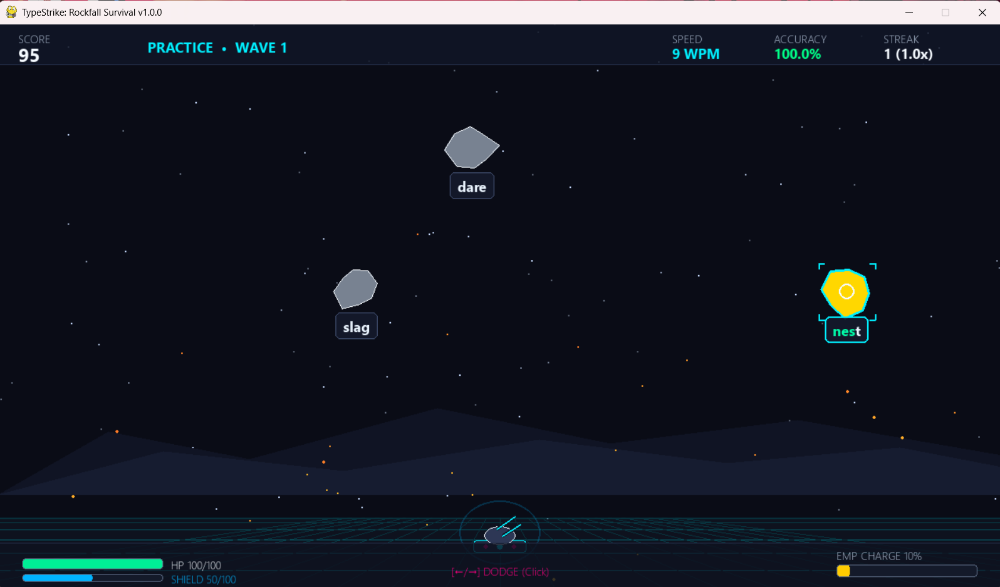
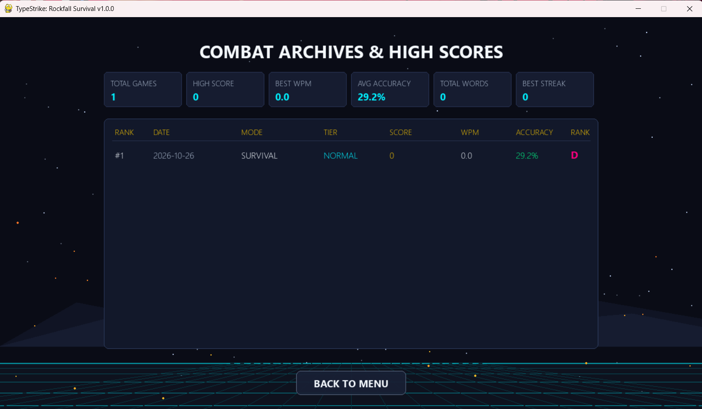
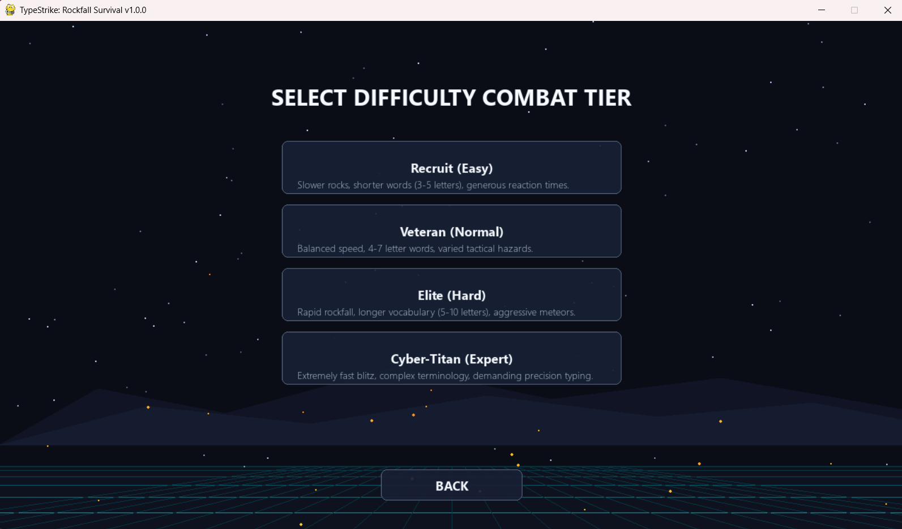

# TypeStrike: Rockfall Survival 🚀💥

[](https://www.python.org/)
[](https://pyga.me/)
[](https://numpy.org/)
[](LICENSE)
[](#testing)

An intense, arcade-style typing combat game combining reflexes, survival defense, intelligent typographic targeting, and real-time psychomotor analytics.

---

## 📸 Screenshots

| Main Menu | In-Game Combat |
| :---: | :---: |
|  |  |

| Post-Game Analytics Dashboard | Historical Statistics |
| :---: | :---: |
|  |  |

---

## 🎮 Gameplay Overview

Defend your cyber-turret from incoming kinetic meteors descending from orbit. Each hazard is procedurally labeled with vocabulary words categorized by difficulty and character patterns.

- **Type to Aim & Fire**: Typing correct letters directs the plasma cannon toward the target and fires high-velocity bolts.
- **Smart Target Lock-on**: The engine dynamically locks onto the lowest/closest hazard matching your initial letter.
- **Hazard Classes**:
  - **Normal Rocks**: Standard descent speed and baseline vocabulary.
  - **Fast Rocks**: High-speed threats requiring instant twitch reactions.
  - **Armored Rocks**: Multi-hit reinforced meteors with multi-character vocabulary.
  - **Explosive Rocks**: Detonate upon destruction, destroying nearby meteors.
  - **Power-up Rocks**: Drop active buffs (*Chrono-Slow*, *Shield Boost*, *Overcharge*).
  - **Boss Rocks**: Colossal hazards carrying multi-word technical phrases.
- **Defensive Manoeuvres**:
  - **Dodge-Dash (`SPACE`)**: Evasive burst with invulnerability frames (i-frames).
  - **EMP Shockwave (`ENTER`)**: Radial screen-clearing pulse charged by high-accuracy streaks.

---

## ✨ Key Features

- **⚡ Sub-Millisecond Lexical Targeting Engine**: Event-driven keystroke validation with zero input lag ($<16\text{ ms}$). Real-time prefix highlighting and typo alerts.
- **🔊 100% Procedural Audio Synthesizer**: No external `.wav` or `.mp3` assets required. All sound effects (lasers, explosions, alarms) are synthesized dynamically in memory using NumPy mathematical waveform arrays.
- **📊 Professional Typographic Analytics**:
  - Standard international 5-character word convention for **Gross WPM** and **Net WPM**.
  - Real-time keystroke and word completion accuracy tracking.
  - Active-pause compensation to prevent idle time from skewing typing speed.
  - Automated arcade ranking: **S+**, **S**, **A**, **B**, **C**, **D**.
- **💾 Local SQLite Telemetry Store**: ACID-compliant persistence for leaderboards, session history, and custom user configurations.
- **🌌 Parallax Sci-Fi Atmosphere**: Multi-layered starfields, distant volcanic mountain ridges, retro perspective cyber grid floor, and camera shake.

---

## 🕹️ Controls

| Key / Action | Function |
| :--- | :--- |
| **A – Z** | Type matching characters to target and destroy hazards |
| **SPACE** | Evasive Dodge-Dash (invulnerability frames) |
| **ENTER** | Trigger EMP Shockwave (when gauge is full) |
| **ESC / P** | Pause game / Open in-game options menu |
| **Mouse Left-Click** | UI navigation and button interaction |

---

## 🚀 Getting Started

### Prerequisites
- Python **3.10** or higher
- Git

### Installation

1. **Clone the repository:**
   ```bash
   git clone https://github.com/AdityaChauhan20011/TypeStrike-Rockfall-Survival.git
   cd TypeStrike-Rockfall-Survival
   ```

2. **Create and activate a virtual environment:**
   ```bash
   # Windows (PowerShell)
   python -m venv .venv
   .venv\Scripts\Activate.ps1

   # macOS / Linux
   python3 -m venv .venv
   source .venv/bin/activate
   ```

3. **Install dependencies:**
   ```bash
   pip install -r requirements.txt
   ```

4. **Launch the game:**
   ```bash
   python main.py
   ```

---

## 🧪 Testing

The project includes an automated headless unit test suite verifying typing mathematics, collision logic, database transactions, and vocabulary loading:

```bash
python test_game.py
```

---

## 📁 Project Architecture

```
TypeStrike-Rockfall-Survival/
├── main.py                     # Application entry point & State Machine
├── requirements.txt            # Project dependencies (pygame-ce, numpy)
├── test_game.py                # Automated headless test suite
├── assets/
│   └── words/                  # Vocabulary text files
│       ├── easy.txt
│       ├── normal.txt
│       ├── hard.txt
│       ├── tech.txt
│       └── boss_phrases.txt
├── data/                       # Local SQLite runtime database
│   └── .gitkeep
├── docs/                       # Project documentation & screenshots
│   ├── CASE_STUDY_SYNOPSIS.md  # Academic case study & architecture dossier
│   └── screenshots/
│       ├── menu.png
│       ├── gameplay.png
│       ├── results.png
│       └── stats.png
└── src/
    ├── config.py               # Constants, display config, and palettes
    ├── analytics/              # WPM, accuracy, and performance grading
    │   └── stats_tracker.py
    ├── audio/                  # Procedural sound generator & audio manager
    │   ├── audio_manager.py
    │   └── sound_gen.py
    ├── engine/                 # Core loop, background parallax, scene manager
    │   ├── background.py
    │   └── game_scene.py
    ├── entities/               # Player turret, rocks, projectiles, particles
    │   ├── particle.py
    │   ├── player.py
    │   ├── powerup.py
    │   ├── projectile.py
    │   └── rock.py
    ├── storage/                # SQLite database persistence layer
    │   └── db_manager.py
    ├── typing/                 # Keystroke validation & target lock engine
    │   ├── typing_engine.py
    │   └── word_dict.py
    └── ui/                     # Heads-up display, menus, and UI widgets
        ├── components.py
        ├── hud.py
        ├── menu_screens.py
        └── results_screen.py
```

---

## 📄 Case Study & Academic Report

For a deep-dive academic and software engineering evaluation covering mathematical models, HCI design, and system architecture, see:
📖 [Project Synopsis & Case Study](docs/CASE_STUDY_SYNOPSIS.md)

---

## 📜 License

This project is licensed under the [MIT License](LICENSE).
